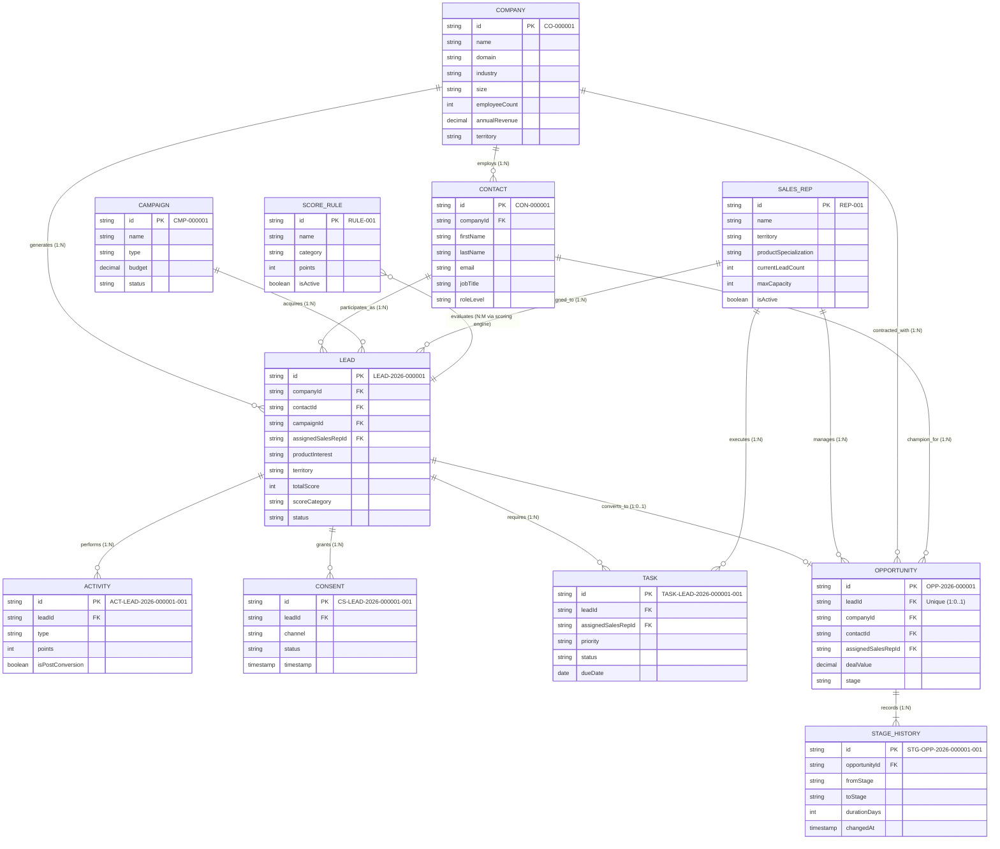

# LEADPULSE AI – Entity Relationship Architecture & Cardinality Model

## 1. Architectural Overview
The **LEADPULSE AI** data architecture is structured as a normalized relational model implemented on top of Firebase Cloud Firestore and exportable to PostgreSQL. Referential integrity is strictly enforced at the application, rule, and schema levels.

Parent records must be provisioned before dependent child records to ensure 100% foreign key validity.

---

## 2. Mermaid Entity Relationship Diagram



---

## 3. Relational Cardinality Specifications

### 1. Company &rarr; Contact (1 : N)
- **Parent:** `Company` (`CO-000001`)
- **Child:** `Contact` (`CON-000001`)
- **Foreign Key:** `Contact.companyId` &rarr; `Company.id`
- **Cardinality:** One company may employ between 1 and 100+ contacts. A contact belongs to exactly one company.

### 2. Company &rarr; Lead (1 : N)
- **Parent:** `Company` (`CO-000001`)
- **Child:** `Lead` (`LEAD-2026-000001`)
- **Foreign Key:** `Lead.companyId` &rarr; `Company.id`
- **Cardinality:** Multiple leads may originate from the same enterprise account across different departments, years, or product divisions.

### 3. Contact &rarr; Lead (1 : N)
- **Parent:** `Contact` (`CON-000001`)
- **Child:** `Lead` (`LEAD-2026-000001`)
- **Foreign Key:** `Lead.contactId` &rarr; `Contact.id`
- **Cardinality:** A business professional may submit multiple inquiries over time for different software tiers.

### 4. Campaign &rarr; Lead (1 : N)
- **Parent:** `Campaign` (`CMP-000001`)
- **Child:** `Lead` (`LEAD-2026-000001`)
- **Foreign Key:** `Lead.campaignId` &rarr; `Campaign.id`
- **Cardinality:** One acquisition campaign generates multiple leads across target territories.

### 5. SalesRep &rarr; Lead (1 : N)
- **Parent:** `SalesRep` (`REP-001`)
- **Child:** `Lead` (`LEAD-2026-000001`)
- **Foreign Key:** `Lead.assignedSalesRepId` &rarr; `SalesRep.id` (Nullable)
- **Cardinality:** One sales executive owns multiple leads within their territory and product domain. Unassigned leads retain a null foreign key.

### 6. Lead &rarr; Activity (1 : N)
- **Parent:** `Lead` (`LEAD-2026-000001`)
- **Child:** `Activity` (`ACT-LEAD-2026-000001-001`)
- **Foreign Key:** `Activity.leadId` &rarr; `Lead.id`
- **Cardinality:** One lead accumulates an ongoing chronological stream of behavioral and sales interactions.

### 7. Lead &rarr; Consent (1 : N)
- **Parent:** `Lead` (`LEAD-2026-000001`)
- **Child:** `Consent` (`CS-LEAD-2026-000001-001`)
- **Foreign Key:** `Consent.leadId` &rarr; `Lead.id`
- **Cardinality:** One lead can record multiple consent events across channels (Email, Phone, SMS, Marketing) and time (Opt-in, Modification, Withdrawal).

### 8. Lead &rarr; Task (1 : N)
- **Parent:** `Lead` (`LEAD-2026-000001`)
- **Child:** `Task` (`TASK-LEAD-2026-000001-001`)
- **Foreign Key:** `Task.leadId` &rarr; `Lead.id`
- **Cardinality:** One lead generates follow-up SLA tasks depending on priority score (`HOT`: 1-Day, `WARM`: 3-Day, `COLD`: Nurture). Duplicate tasks are suppressed by `idempotencyKey`.

### 9. Lead &rarr; Opportunity (1 : 0..1)
- **Parent:** `Lead` (`LEAD-2026-000001`)
- **Child:** `Opportunity` (`OPP-2026-000001`)
- **Foreign Key:** `Opportunity.leadId` &rarr; `Lead.id`
- **Cardinality:** A lead generates at most **one** active commercial opportunity upon conversion.
- *Negative Scenario Exception:* Anomaly 4 tests intentional violation where a duplicate opportunity is generated for the same lead.

### 10. Opportunity &rarr; StageHistory (1 : N)
- **Parent:** `Opportunity` (`OPP-2026-000001`)
- **Child:** `StageHistory` (`STG-OPP-2026-000001-001`)
- **Foreign Key:** `StageHistory.opportunityId` &rarr; `Opportunity.id`
- **Cardinality:** Each opportunity records an immutable progression log documenting each stage transition (`NEW` &rarr; `QUALIFIED` &rarr; `PROPOSAL` &rarr; `NEGOTIATION` &rarr; `WON`/`LOST`).

---

## 4. Referential Sequencing and Ingestion Hierarchy
To guarantee zero foreign key violations during synthetic data generation or database seeding, collections are created strictly according to dependency depth:

```
[Level 1: Independent Master Records]
  ├── Companies (CO-XXXXXX)
  ├── Campaigns (CMP-XXXXXX)
  ├── Sales Representatives (REP-XXX)
  └── Scoring Rules (RULE-XXX)
        │
[Level 2: Account Dependent Contacts]
  └── Contacts (CON-XXXXXX) -> requires Company
        │
[Level 3: Core Transactional Leads]
  └── Leads (LEAD-2026-XXXXXX) -> requires Company, Contact, Campaign, SalesRep
        │
[Level 4: Lead Child Touchpoints & Workflows]
  ├── Activities (ACT-LEAD-...) -> requires Lead
  ├── Consents (CS-LEAD-...) -> requires Lead
  ├── Tasks (TASK-LEAD-...) -> requires Lead, SalesRep
  └── Opportunities (OPP-2026-...) -> requires Lead, Company, Contact, SalesRep
        │
[Level 5: Opportunity Audit Trace]
  └── StageHistory (STG-OPP-...) -> requires Opportunity
```

---

## 5. Foreign Key Integrity Invariant Rules
1. **No Orphan Records:** A child record may never be created if its corresponding foreign key does not exist in the active parent collection.
2. **Cascade Behavior:**
   - Soft Deletion: Parent record deletions set `lifecycle_status = 'ARCHIVED'` rather than cascading physical document deletes.
   - Child updates retain historical foreign key pointers.
3. **Primary Key Immutability:** Once assigned, primary keys are never regenerated or mutated during updates.
